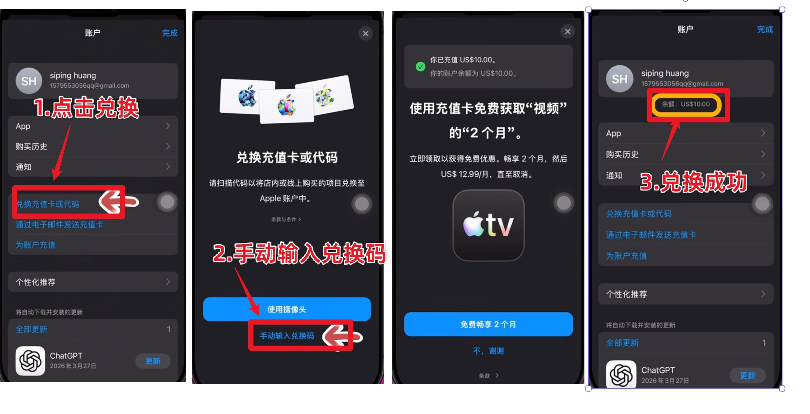

# Windows＋iPad 实操补充（2026-10-18）

本章接续原版，不替代原版从账号、VPS、网络、浏览器到 Apple 内购的顺序。不重复购买或部署已有可用环境。以下是一次实际使用的补充，不代表所有设备、地区或未来版本均相同，不保证不封号。

## 1. 本次已跑通和未验证的范围
- Windows 上已完成 v2rayN、AdsPower 专用环境及实际出口检查；电脑 Claude 账号显示 Pro，已正常对话。
- iPad 上已连接同一服务器的独立兼容入口；检测页显示预期出口，DNS 与 WebRTC/UDP 检测未报告泄露。时区用户反馈已修改。
- 用户确认通过长期使用的美区 Apple 账户、礼品卡路线订阅完成；随后电脑同账号 Pro 和回复已观察到。没有将完整收据写入公开包。
- Claude Code 已安装、使用同一个 Pro 账号授权，并实际收到中文回复。
- iPad 的 IPv6、完整时区开关复查、节点故障与客户端关闭的直连行为等没有完整证据；保持“未验证”，不把订阅成功当作全部网络验收通过。

## 2. Windows 继续按原版配置
按 [Windows 专章](10-windows.md)，保留旧网络供配置和恢复，先测新节点再切换。电脑默认维持原版所选的系统代理关闭、TUN 开启、全局路由；本机 HTTP/混合入口单独核对供 AdsPower 使用。
本次使用 v2rayN 7.25.6 和独立 AdsPower 环境实际完成对话，但版本仅为实操记录，不固定安装该版本、不固定 UA。服务端与客户端兼容性、软件来源和价格依原教程现查。
AdsPower HTTP 地址和端口用本人电脑实际值，不照抄截图；已有环境继续使用，不重建指纹或重复登录。

## 3. iPad 替代原版 iPhone 操作时的细节
Windows 不套用 Mac 的 iPhone 镜像操作；按真实 iPad 截图一步步带做。系统和 App 要满足当前 [Claude 官方安装要求](https://support.claude.com/en/articles/9266462-install-claude-for-ios)。
Shadowrocket 导入节点后，要点节点名称使选中标记落到该行，再开启首页顶部连接开关。“已导入”“有节点名称”和 VPN 图标不能单独作为成功证据。
全局路由仍按原版选“代理”。顶部显示正确连接名后，再在 Safari 查看出口；等待检测完成。刚打开显示获取失败时不能立即判定失败；断开连接时显示本地出口也不能判节点失效。
若原 Reality 节点超时，先核对导出配置、服务运行、端口、日志、实际版本和兼容性，避免凭照片重抄密钥。此次在保留原 Windows 入口的同时增加独立 Shadowsocks 2022 兼容入口，iPad 随后测通；这只是本次解决方式，不是所有用户都要加服务或降级的结论。需要服务变更先说明，保留原入口；不把私人二维码、UUID、密码、公钥组合发布到教程。
按 [原版登录前检查](06-before-login.md) 分别记录出口、IPv6、DNS、WebRTC、App 路径、时区与断线行为。中文可保留，未观察到的开关标未验证。美国 IP、时区和评分都不是服务资格或防封保证；注册前核对 [官方支持地区](https://www.anthropic.com/supported-countries)，不绕过地区或身份限制。

## 4. Apple 账号：复用原版账户检查
继续原版 [Apple 章节](03-apple.md) 的账户类型、控制权、等待建议和余额检查。
长期正常使用的美区账号无需重新计两天；刚注册或刚接手账号仍按原版说明约两天正常使用建议，它是作者经验，不是 Apple 官方规则，也不保证解除购买限制。
如用户已有购买账号，不因能登录或改了姓名就认定完全归本人；本人更换密码、确认控制邮箱及其恢复方式、受信任手机号和设备。不要收取用户密码、密保、兑换码或验证码。不为了内购把控制权不明的账号登录系统 iCloud。
美区 Apple 付款账号与 Claude 的 Google/邮箱账号是不同账户，付款前分别核对。账单资料如实填写，不提供假地址或随意拼邮编；地区变化按 Apple 官方流程。

## 5. 礼品卡补充：确认、兑换、余额、订单
按原版的 [礼品卡购买与兑换](03-apple.md) 操作，不自动购买、不指定用户必须向某个卖家付款。
1. 先确认美区付款账户可正常使用、是否已有余额、有没有购买限制；若 Claude 已提示身份验证或不符合服务条件，先处理，不追加充值。
2. 购买与该账户地区匹配的 Apple Gift Card。核对地区、币种、金额、来源和售后，优先 [Apple 官方渠道](https://www.apple.com/shop/gift-cards)。礼品卡、App Store 内购与 Apple Pay 不是同一概念。
3. 在 iPad 打开 App Store → 头像 → 核对付款账户 → “兑换充值卡或代码” → 本人输入兑换码 → 回头像页确认余额。验证码和卡密不发聊天。

余额要覆盖最终金额与适用税费。此次页面显示 Pro 月付 20 美元，仅为该次观察，不能写成所有时间地区固定价格。已有足额余额不再追加购买；部分购买可能仍要求有效付款方式，按 [Apple 余额用途说明](https://support.apple.com/zh-cn/118245) 和实际提示处理，不能保证只充余额必成功。

## 6. Claude 注册：沿用原版 Google 登录
没有 Claude 账号时：App Store 安装 Anthropic 官方 Claude → 打开 App → Continue with Google → 本人选择自己的 Google 账号并完成验证 → 如实确认所需信息与条款 → 发送一句中文测试。
已有 Claude 账号就用原登录方式，不重复注册。若当前界面使用邮箱登录链接也可按实际页面处理，不让用户发送链接或验证码。用 Apple 余额支付不要求改选 Continue with Apple，避免不小心产生另一 Claude 账号。

出现政府证件或摄像头验证时按 [官方说明](https://support.claude.com/en/articles/14328960-identity-verification-on-claude) 本人完成，不以换号、换支付方式绕过。无法完成时联系官方支持，不承诺礼品卡可跳过验证。

## 7. iPad 内购与电脑验收
在 Claude App 中确认准备订阅的账号 → 升级 → Pro → 选择月付（用户另选年付时按其选择）→ 获取 Pro 套餐。
本人核对 Apple 原生确认窗口中的账号、套餐、周期、最终金额和自动续费说明，再按实际设备提示付款。有 Home 键的 iPad 可能使用 Touch ID/密码，不一律说“双击侧边键刷脸”。余额实际是否扣款按订单和余额变化核实，不能凭充值完成推断。

付款后分别确认：Apple 订单完成、App 当前 Claude 账号显示 Pro、电脑同一个 Claude 账号显示 Pro 且完成正常回复。三项齐全才记订阅完成。
无法购买按 [原版 Apple 支持章节](07-apple-purchase-support.md) 排查；已扣款未到账先核对账号与订单、按 App 提供的恢复购买入口或官方支持处理，不重复订阅。退款由 Apple 审核，不承诺封号必退；[退款申请](https://support.apple.com/zh-cn/118223) 与取消续费不同。

## 8. 可选：用户明确要 Claude Code 时
原版主线仍以 Pro 和电脑正常对话为终点。用户另行要求 Claude Code 时，再按 [官方安装](https://code.claude.com/docs/en/setup) 安装并运行版本检查；Windows 使用实际 Git 路径、本人网络入口及选定的工作文件夹，不固定本次版本或端口。
首次主题选择 → 选 Claude account with subscription → 用同一个 Pro 账号授权。若默认浏览器打开登录页，可把本次授权网址复制到原 AdsPower 环境，本人核对并授权。授权码只填回本机 Claude Code，不发聊天；网页成功后还要回 CLI 确认。
本人阅读安全说明、核对要信任的具体文件夹，然后发送“你好，请用中文回复，先不读取或修改文件，只确认能否正常对话”。实际收到回复才记 Claude Code 验收。
此操作不安装 Claude Desktop，也不选择 Console API 计费。需要登录的 Claude 官方页面可在已选环境处理，不要求所有本地开发网页都迁入指纹浏览器。

## 9. 本次日常关闭与开启顺序
关闭：任务完成 → Claude Code 输入 /exit 回车 → 确认回普通命令提示符并关终端 → AdsPower 关闭 Claude 专用环境，已打开数为 0 → iPad 退出 Claude App/相关页面 → 最后关闭电脑 TUN 或 iPad 小火箭连接，使用本地网络。保留时区、账号登录和节点设置，不清缓存。
开启：先开原网络客户端、选原节点、恢复已验收的 TUN/全局或 iPad“代理”模式 → 确认实际出口和连通 → 再开原 AdsPower 环境或 Claude Code。CLI 启动脚本使用了本机代理入口时必须先运行该入口，不能仅打开浏览器代理。
这些步骤减少操作与连接错误，不保证不封号；换网络前先退出 Claude，不把客户端关闭解释成设备一定断网。

## 10. 可直接交给下一位用户的提示词
> 请读取本包 SKILL.md，延续原版从头带做，并结合 references/16-windows-ipad-apple-practice.md。先确认我的设备、服务资格、账号和现有网络，不重复购买已有资源；按美区 Apple 账户＋对应礼品卡＋官方 App 内购路线，每次指导一个小步骤。密码、验证码、卡密、身份核验和最终付款由我自己处理。不能将上一位用户的网络检查或凭据用于我的设备。

记录用本人的 .local/progress.md，不含公开 IP、邮箱、密码、卡密、授权链接或账单。各设备单独记录观察、口述与未验证项目，不复制本次用户的检查结论。

公开入口：https://github.com/monadgccg754678-ctrl/claude-setup-guide-windows-ipad 。用户仅发送入口链接时也按第10节开始带做，首次下载和更新只访问本增补仓库。
